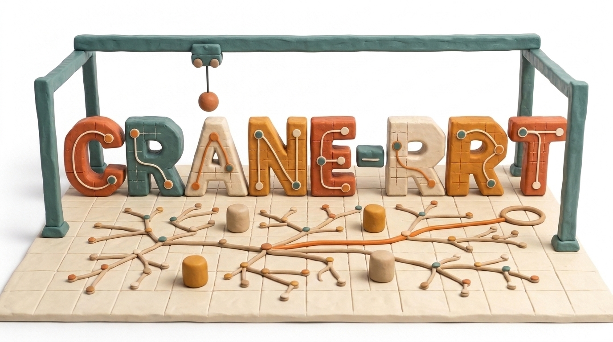
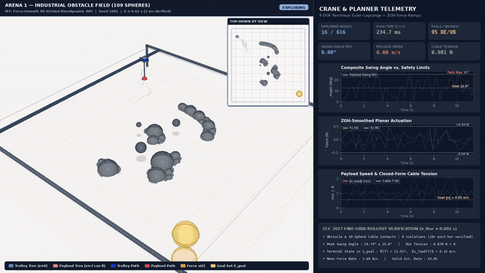
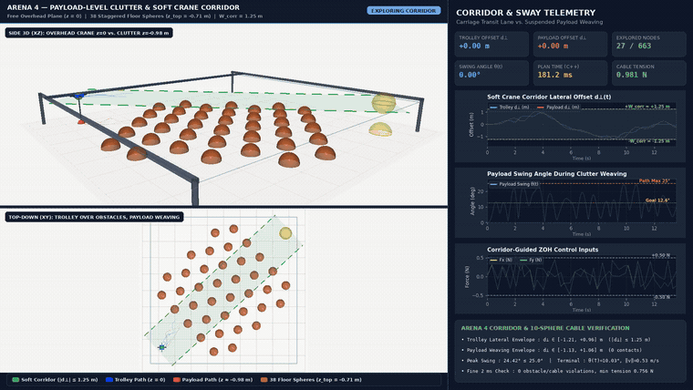
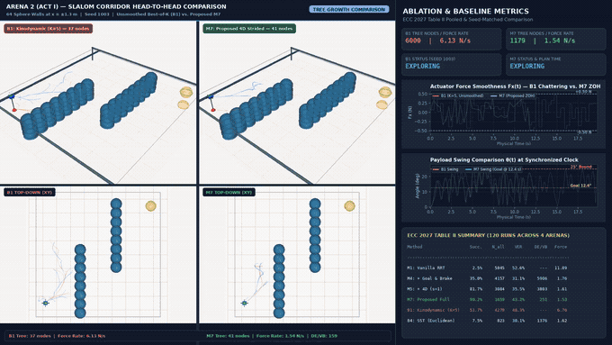

# CRANE-RRT

Force-Smooth Kinodynamic RRT Planning for Sway-Constrained Three-Dimensional Gantry Cranes



ROS 2 simulation, interactive visualization, and standalone benchmark suite for **Force-Smooth Kinodynamic RRT Planning for Sway-Constrained Three-Dimensional Gantry Cranes** (ECC 2027).

This repository provides:
1. **Nonlinear 3D Gantry Crane ROS 2 Simulator & Interactive RRT Explorer** (`simulator_node`, `visualizer_node`, `arena_visualizer_node`, `rrt_exploration_node`, RViz2 configurations, and Python control panels).
2. **Reproducible ECC 2027 Benchmark Executable (`ecc_benchmark`)** replicating all mathematical checks, RK4 convergence/timing tests, held-out hyperparameter tuning (`seeds 2001..2005`), the 14-method × 4-arena × 30-seed ablation and baseline suite (**Table II**), and the terminal quiescence sensitivity study (**Table III**).

---

## Simulation Videos

<p align="center">
  <a href="https://cdn.jsdelivr.net/gh/ozaslan/crane_rrt@main/videos/01_industrial_arena_exploration.mp4">
    
  </a>
</p>

<p align="center">
  <a href="https://cdn.jsdelivr.net/gh/ozaslan/crane_rrt@main/videos/02_payload_clutter_soft_corridor.mp4">
    
  </a>
</p>

<p align="center">
  <a href="https://cdn.jsdelivr.net/gh/ozaslan/crane_rrt@main/videos/03_slalom_pillar_ablation_comparison.mp4">
    
  </a>
</p>

---

## 1. Dependencies & Build

Tested on Ubuntu 24.04 with **ROS 2 Jazzy** (also compatible with ROS 2 Humble) and a C++17 compiler:

```bash
sudo apt update
sudo apt install -y \
  libeigen3-dev \
  libyaml-cpp-dev \
  libboost-dev \
  libopencv-dev \
  python3-pyqt5 \
  python3-tk
```

Clone into a ROS 2 workspace and build with `colcon`:

```bash
mkdir -p ~/crane_ws/src
cd ~/crane_ws/src
git clone https://github.com/ozaslan/crane_rrt.git
cd ~/crane_ws
source /opt/ros/jazzy/setup.bash   # or /opt/ros/humble/setup.bash
rosdep install --from-paths src --ignore-src -r -y
colcon build --cmake-args -DCMAKE_BUILD_TYPE=Release
source install/setup.bash
```

---

## 2. Running the ROS 2 Simulator & Interactive RRT Explorer

### 2.1 Interactive Kinodynamic RRT Exploration (RViz2 + PyQt5 Control Panel)

Launch live RRT tree growth, planned trajectory playback, 3D obstacle visualization, and the interactive parameter/preset GUI:

```bash
ros2 launch crane_rrt rrt_exploration.launch.py
```

Select any of the four ECC 2027 benchmark arenas directly from the GUI or at launch time:

```bash
ros2 launch crane_rrt rrt_exploration.launch.py arena:=Arena1_ImageIndustrial
ros2 launch crane_rrt rrt_exploration.launch.py arena:=Arena2_SlalomCorridor
ros2 launch crane_rrt rrt_exploration.launch.py arena:=Arena3_DensePillarYard
ros2 launch crane_rrt rrt_exploration.launch.py arena:=Arena4_PayloadClutterCorridor
```

All 14 planner configurations from **Table II** (`M1_Vanilla`–`M7_ProposedFull`, `M7_RandSub`, `M7_ForceHist`, `B1_LaValleBestK`–`B4_SST_4D`) are selectable as presets in the PyQt5 control panel.

### 2.2 Manual Open-Loop 4-DOF Crane Simulation

Launch the nonlinear 4-DOF Euler–Lagrange gantry crane simulator with RViz2 and keyboard/button force control (`/gantry_force_input`):

```bash
ros2 launch crane_rrt crane_sim.launch.py
# Optional obstacle arena with live payload collision highlighting:
ros2 launch crane_rrt crane_sim.launch.py arena:=Arena1_ImageIndustrial
```

---

## 3. Replicating the ECC 2027 Experiments

Run `ecc_benchmark` via `ros2 run crane_rrt ecc_benchmark` (after `source install/setup.bash`):

1. **Quick Verification & 4-Arena Smoke Test** (Lemma 1 spectral & Schur-complement checks, closed-form cable tension positivity, 3D sphere/ellipsoid collision checks, and `M7_ProposedFull` on seed `1001` with `0.002 s` post-hoc rollout check):
   ```bash
   ros2 run crane_rrt ecc_benchmark --quick
   ```

2. **RK4 Step-Size Convergence, Energy Balance & Timing Study (Sections III & V)**:
   ```bash
   ros2 run crane_rrt ecc_benchmark --rk4
   ```
   Writes `results/rk4_convergence.csv`.

3. **Held-Out Hyperparameter Tuning (`seeds 2001..2005`)**:
   Tunes `w_u` for `M7_ForceHist` (selecting by converged count and deterministic explored-node efficiency `N_all`, with single-thread timing tie-break) and `(δ_bn, δ_s)` for `B4_SST`:
   ```bash
   ros2 run crane_rrt ecc_benchmark --tune
   ```
   Writes `results/tuning_summary.csv`.

4. **Full 14-Method × 4-Arena × 30-Seed Ablation & Baseline Benchmark (Table II)**:
   ```bash
   ros2 run crane_rrt ecc_benchmark --table2 --threads 2
   ```
   Writes `results/table2_ablation_baselines.csv`. In the summary table, `N_all`, `VER`, and `DE/VB` are averaged over all 120 runs, whereas `Force` (mean RMS force-transition rate) and `T_succ` are averaged over converged runs. The 12 iteration-budgeted methods (`M1`–`M7_ForceHist`, `B1`–`B3`) are strictly deterministic across thread counts, while `B4_SST` and `B4_SST_4D` use a `3.0 s` wall-clock timeout per trial. Individual methods or arenas can also be queried selectively:
   ```bash
   ros2 run crane_rrt ecc_benchmark --table2 --method M7_ProposedFull --method M7_RandSub --method M7_ForceHist
   ```

5. **Terminal Quiescence Sensitivity Study Across Three Profiles (Table III)**:
   Evaluates `M7_ProposedFull`, `M7_RandSub`, `M5_4DPhaseOnly`, and `B4_SST` across Nominal (`12.6°, 0.55 m/s, 0.55 rad/s`), Tighter (`5.0°, 0.20 m/s, 0.20 rad/s`), and Strict (`2.0°, 0.10 m/s, 0.10 rad/s`) terminal safe sets (`seeds 1001..1030`):
   ```bash
   ros2 run crane_rrt ecc_benchmark --table3
   ```
   Writes `results/table3_terminal_sensitivity.csv`.

6. **Run the Complete ECC 2027 Suite End-to-End**:
   ```bash
   ros2 run crane_rrt ecc_benchmark --all
   ```

---

## License

MIT License — see [LICENSE](LICENSE).

